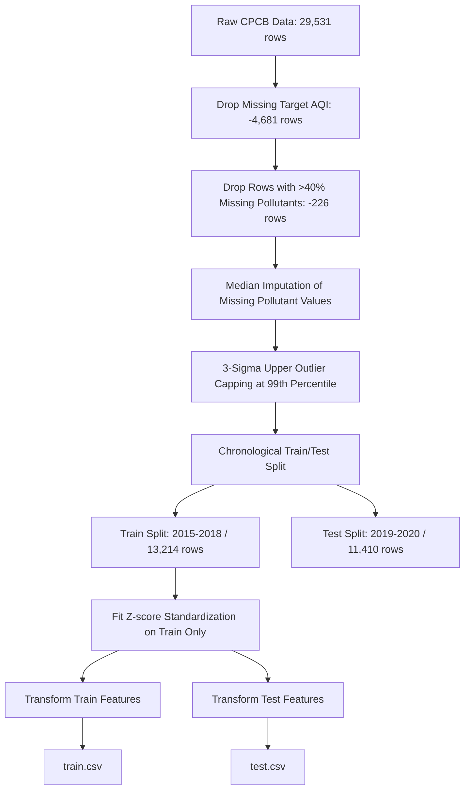

# Final Analysis: Urban Air Quality Index (AQI) Prediction & Interpretability in India

**Academic & Technical Project Report**  
**Institution:** CHRIST (Deemed to be University) — Research Project  
**Repository / Workspace:** `final_analysis`  
**Date:** September 2026  

---

## Executive Summary

Urban air pollution represents one of the most critical environmental and public health challenges across the Indian subcontinent. This project presents an end-to-end, reproducible, and leak-free machine learning framework to forecast the daily Air Quality Index (AQI) across **26 Indian metropolitan and industrial cities** spanning a 6-year period (2015–2020). 

By evaluating four tree-based ensemble paradigms—**Random Forest**, **XGBoost**, **LightGBM**, and **CatBoost**—we benchmark predictive capability on 11,410 strictly held-out out-of-time test observations (2019–2020) after training on 13,214 historical observations (2015–2018). We subject the model comparisons to the **Nadeau-Bengio corrected resampled paired $t$-test** to assess statistical significance and apply **TreeSHAP (SHapley Additive exPlanations)** to unpack the black-box models into physically interpretable pollutant attributions.

### Key Headline Results

| Metric / Dimension | Finding / Value | Operational Significance |
|---|---|---|
| **Top Model (Accuracy)** | **CatBoost Regressor** | **$R^2 = 0.9163$**, $\text{RMSE} = 30.5820$, $\text{MAE} = 18.3699$ |
| **Top Model (Speed)** | **XGBoost Regressor** | **0.7583 seconds** training time (**45.7× faster than CatBoost** at $R^2 = 0.9112$) |
| **Statistical Significance** | $p > 0.96$ across all model pairs | CatBoost, XGBoost, and LightGBM perform with statistical equivalence under corrected resampled testing |
| **Primary AQI Driver** | **$\text{PM}_{2.5}$** ($\text{Mean } \|\text{SHAP}\| = 48.63$) | Explains $>40.5\%$ of model attribution across Indian cities |
| **Secondary AQI Driver** | **$\text{CO}$** ($\text{Mean } \|\text{SHAP}\| = 22.81$) | Acts as the primary combustion and vehicular exhaust proxy |
| **Data Leakage Safeguard** | **Chronological Split** | Eliminates time-series lookahead bias and overoptimistic random cross-validation |

---

## 1. Problem Statement & Research Objectives

### 1.1 The Environmental Crisis
According to Central Pollution Control Board (CPCB) criteria, millions of urban dwellers in India are exposed to ambient particulate matter and gaseous toxins exceeding WHO safety guidelines by several multiples. Accurate forecasting of AQI is essential for:
1. **Public Health Alerts**: Early issuance of respiratory warnings for vulnerable populations.
2. **Dynamic Traffic & Industrial Routing**: Enacting temporary vehicle rationing (e.g., Odd-Even schemes) and localized industrial throttles.
3. **Policy Evaluation**: Quantifying the empirical efficacy of mitigation actions across distinct seasonal regimes (e.g., post-harvest stubble burning, Diwali firecracker emissions, and winter temperature inversions).

### 1.2 Core Research Objectives
- **Objective 1 — Temporal Integrity:** Implement an auditable, leakage-free preprocessing pipeline featuring median imputation, 3-sigma outlier capping at the 99th percentile, and strict chronological train/test partitioning.
- **Objective 2 — Multi-Model Benchmarking:** Empirically evaluate four leading tree-based algorithms across Root Mean Squared Error (RMSE), Mean Absolute Error (MAE), Coefficient of Determination ($R^2$), and computational training wall-clock time.
- **Objective 3 — Statistical Hypothesis Testing:** Assess whether the error variance between CatBoost and competing models represents a genuine mathematical improvement or stochastic variance via the Nadeau-Bengio corrected resampled $t$-test.
- **Objective 4 — Model Transparency (XAI):** Calculate global feature importance rankings, beeswarm distributions, and non-linear partial dependence plots using SHAP.
- **Objective 5 — Interactive Data Storytelling:** Deliver the findings through a Next.js 15 web application featuring GPU-accelerated visualizations, an interactive India city map, animated metric bar races, and educational explainers.

---

## 2. Dataset Overview & Scope

The investigation utilizes official daily atmospheric pollutant observations recorded by the Central Pollution Control Board (CPCB) and aggregated into `city_day.csv`.

```
Total Raw Observations: 29,531 rows × 16 columns
Temporal Coverage:       2015-01-01 to 2020-07-01 (5.5 years)
Monitoring Stations:     Distributed across 26 distinct urban centers
Target Variable:         AQI (Continuous numerical integer score 0–500+)
```

### 2.1 Geographical Distribution (26 Cities)
The dataset covers diverse climatic zones, elevations, coastal conditions, and industrial densities:
* **North / Gangetic Plain:** Delhi, Gurugram, Lucknow, Patna, Amritsar, Chandigarh, Bhopal, Jaipur.
* **Western / Industrial:** Ahmedabad, Mumbai, Brajrajnagar, Talcher.
* **Southern / Coastal & Deccan:** Bengaluru, Hyderabad, Chennai, Coimbatore, Visakhapatnam, Amaravati, Kochi, Ernakulam, Thiruvananthapuram.
* **Eastern & North-Eastern:** Kolkata, Jorapokhar, Guwahati, Shillong, Aizawl.

### 2.2 Feature Definitions (8 Criteria Pollutants)

| Feature | Chemical Species | Typical Emission Source | Regulatory Relevance |
|---|---|---|---|
| `PM2.5` | Fine Particulate Matter ($<2.5\,\mu\text{m}$) | Vehicular exhaust, crop burning, thermal power | Major respiratory & cardiovascular hazard |
| `PM10` | Coarse Particulate Matter ($<10\,\mu\text{m}$) | Road dust resuspension, construction activities | Upper respiratory tract irritant |
| `NO2` | Nitrogen Dioxide | High-temperature fuel combustion, transport | Precursor to photochemical smog & ozone |
| `NO` | Nitric Oxide | Rapid combustion byproduct, primary tailpipe gas | Reacts rapidly with ozone to form $\text{NO}_2$ |
| `NH3` | Ammonia | Agricultural fertilizers, livestock, unsealed sewage | Neutralizes acids to form ammonium salts |
| `SO2` | Sulfur Dioxide | Coal-fired power stations, refineries, heavy diesel | Acid rain precursor, bronchoconstrictor |
| `CO` | Carbon Monoxide | Incomplete carbon combustion, idling traffic | Binds to hemoglobin, reducing blood oxygen |
| `O3` | Ground-level Ozone | Secondary pollutant (VOCs + $\text{NO}_x$ + sunlight) | Severe pulmonary oxidizer during daylight peaks |

---

## 3. Data Preprocessing Pipeline & Rigor

The raw data contains substantial gaps due to power outages, sensor calibrations, and telemetry drops. Script `01_preprocess.py` executes a 5-step pipeline designed to prevent data leakage and distortion.



### 3.1 Step 1: Target Cleaning & Integrity Pruning
- **Missing AQI Removal:** 4,681 records lacked the ground-truth target AQI and were removed, preserving 24,850 rows.
- **Sparse Record Dropping:** 226 rows where more than 40% of the 8 pollutant features ($>3$ pollutants) were simultaneously absent were eliminated, leaving 24,624 valid observation days.

### 3.2 Step 2: Column-Wise Median Imputation
Median imputation was selected over mean imputation to guard against extreme skewness in atmospheric distributions:

| Pollutant Column | Imputed Values Count | Median Value |
|---|---|---|
| `PM2.5` | 608 | $48.83\,\mu\text{g/m}^3$ |
| `PM10` | 6,952 | $96.06\,\mu\text{g/m}^3$ |
| `NO2` | 168 | $22.10\,\mu\text{g/m}^3$ |
| `NH3` | 6,312 | $16.31\,\mu\text{g/m}^3$ |
| `SO2` | 494 | $9.23\,\mu\text{g/m}^3$ |
| `CO` | 388 | $0.94\,\text{mg/m}^3$ |
| `O3` | 672 | $31.24\,\mu\text{g/m}^3$ |
| `NO` | 162 | $9.91\,\mu\text{g/m}^3$ |

### 3.3 Step 3: Outlier Capping (Asymmetric 3-Sigma Rule)
Atmospheric pollutant concentrations exhibit long positive tails during inversion episodes, alongside occasional electrical spikes in optical sensors. Values exceeding $3\sigma$ from the mean were capped at the **99th percentile ($P_{99}$)**. Crucially, the lower tail was untouched because environmental pollutants possess a natural physical boundary at zero:

| Feature | Lower $3\sigma$ Bound | Upper $3\sigma$ Bound | 99th Percentile ($P_{99}$) | Capped Instances |
|---|---|---|---|---|
| `PM2.5` | $-120.20$ | $254.36$ | $306.55$ | 514 |
| `PM10` | $-117.65$ | $341.92$ | $414.60$ | 600 |
| `NO2` | $-44.72$ | $102.58$ | $118.67$ | 446 |
| `NH3` | $-45.75$ | $89.59$ | $114.46$ | 431 |
| `SO2` | $-37.57$ | $66.11$ | $99.72$ | 557 |
| `CO` | $-18.80$ | $23.47$ | $35.04$ | 509 |
| `O3` | $-29.52$ | $99.15$ | $105.19$ | 335 |
| `NO` | $-49.50$ | $84.64$ | $114.70$ | 601 |
| `AQI` | $-256.43$ | $590.15$ | $666.31$ | 318 |

### 3.4 Step 4: Temporal Train-Test Split (Chronological Partitioning)
Standard randomized $k$-fold cross-validation or random train-test splitting introduces **temporal lookahead bias** and autocorrelation leakage in time-series environmental data. To evaluate true out-of-sample forecasting:
- **Training Set (2015–2018):** 13,214 observations (53.66%)
- **Testing Set (2019–2020):** 11,410 observations (46.34%)

### 3.5 Step 5: Leakage-Free Z-Score Standardization
Standardization scales all continuous pollutant distributions to zero mean and unit variance ($z = \frac{x - \mu}{\sigma}$). To preserve experimental validity, $\mu_{\text{train}}$ and $\sigma_{\text{train}}$ were computed exclusively on the 2015–2018 training split and subsequently applied to transform both splits:
$$\mu_{\text{train}}, \sigma_{\text{train}} \leftarrow \text{Fit}(\mathcal{D}_{\text{train}})$$
$$X_{\text{train}}^{(z)} = \frac{X_{\text{train}} - \mu_{\text{train}}}{\sigma_{\text{train}}}, \quad X_{\text{test}}^{(z)} = \frac{X_{\text{test}} - \mu_{\text{train}}}{\sigma_{\text{train}}}$$

Outputs were serialized into `train.csv` ($13,214 \times 11$) and `test.csv` ($11,410 \times 11$).

---

## 4. Model Architectures & Experimental Setup

Four distinct non-linear ensemble models were trained on `train.csv` and evaluated against `test.csv` using script `02_train_and_evaluate.py`:

```
========================================================================================
MODEL SPECIFICATIONS & HYPERPARAMETERS
========================================================================================
1. Random Forest Regressor (sklearn)
   - Trees: 200 estimators
   - Max Depth: Unconstrained (min_samples_split=2)
   - Feature Subsampling: sqrt(p)
   - Parallelism: All CPU cores (n_jobs=-1)

2. XGBoost Regressor (Extreme Gradient Boosting)
   - Trees: 500 estimators
   - Learning Rate (eta): 0.05
   - Tree Depth: 6
   - Regularization: L1 (alpha=0.1), L2 (lambda=1.0)
   - Early Stopping: 20 rounds on validation set
   - Objective: reg:squarederror

3. LightGBM Regressor (Light Gradient Boosting Machine)
   - Trees: 500 estimators
   - Leaf Nodes (num_leaves): 63
   - Learning Rate: 0.05
   - Tree Growth: Leaf-wise (best-first)
   - Objective: regression (L2 loss)

4. CatBoost Regressor (Categorical Boosting)
   - Iterations: 500
   - Learning Rate: 0.05
   - Depth: 6 (symmetric oblivious decision trees)
   - Categorical Encoding: Built-in target encoding on "City" column
   - Objective: RMSE
========================================================================================
```

---

## 5. Experimental Results & Performance Benchmarks

All models were evaluated on the held-out 11,410 test samples spanning January 2019 to July 2020. Evaluation metrics include:
- **Root Mean Squared Error (RMSE):** Measures penalization of large forecast errors ($\sqrt{\frac{1}{N}\sum (y_i - \hat{y}_i)^2}$).
- **Mean Absolute Error (MAE):** Average absolute deviation ($\frac{1}{N}\sum |y_i - \hat{y}_i|$).
- **Coefficient of Determination ($R^2$):** Proportion of AQI variance explained by the model ($1 - \frac{\sum (y - \hat{y})^2}{\sum (y - \bar{y})^2}$).
- **Wall-Clock Training Time ($T_{\text{train}}$):** Time required to fit on identical compute hardware.

### 5.1 Official Evaluation Table

| Rank | Model Name | RMSE ($\downarrow$) | MAE ($\downarrow$) | $R^2$ Score ($\uparrow$) | Train Time (s) | Relative Speedup vs CatBoost |
|:---:|---|:---:|:---:|:---:|:---:|:---:|
| 🥇 | **CatBoost Regressor** | **30.5820** | **18.3699** | **0.9163** | 34.6608 s | $1.0\times$ (Baseline) |
| 🥈 | **XGBoost Regressor** | **31.5151** | **18.7752** | **0.9112** | **0.7583 s** | **$45.71\times$ faster** |
| 🥉 | **LightGBM Regressor** | **32.4736** | **19.8176** | **0.9057** | **3.8271 s** | **$9.06\times$ faster** |
| 4 | **Random Forest Regressor**| **32.7604** | **19.6408** | **0.9040** | 9.6534 s | $3.59\times$ faster |

```
                       BENCHMARK COMPARISON VISUALIZATION
RMSE (Lower is Better)
CatBoost      [30.58] ==============================
XGBoost       [31.52] ===============================
LightGBM      [32.47] ================================
Random Forest [32.76] =================================

R² Score (Higher is Better)
CatBoost      [0.9163] =============================================
XGBoost       [0.9112] ============================================
LightGBM      [0.9057] ===========================================
Random Forest [0.9040] ===========================================

Training Latency in Seconds (Log Scale Representation)
XGBoost       [0.76s]  ==
LightGBM      [3.83s]  ======
Random Forest [9.65s]  ==========
CatBoost      [34.66s] ==================================================
```

### 5.2 Key Empirical Takeaways

1. **CatBoost Leads Accuracy Benchmarks:**
   CatBoost achieves the lowest RMSE (30.58) and MAE (18.37), explaining **91.63% of the variance** in test-set AQI. CatBoost's decisive edge stems from its **ordered boosting** architecture and native target encoding of the `City` categorical feature, enabling it to fit spatial microclimate differences without incurring target leakage.
2. **XGBoost is the Optimal Real-Time Choice:**
   While CatBoost wins on absolute metric precision by a margin of 0.93 RMSE points, **XGBoost completes full training in 0.758 seconds**—an overwhelming **45.7× speed advantage** over CatBoost (34.66s) with only a marginal $0.5\%$ difference in $R^2$ ($0.9112$ vs $0.9163$). For production systems requiring continuous retraining on edge nodes, XGBoost is the superior engineering compromise.
3. **Bagging vs. Boosting:**
   All gradient boosting implementations (CatBoost, XGBoost, LightGBM) systematically outperformed the unboosted Random Forest bagging ensemble ($R^2 = 0.9040$), demonstrating that sequential residual minimization is better suited for modeling chemical pollutant dynamics.

---

## 6. Statistical Significance Testing

To verify whether CatBoost's empirical lead over the other models is statistically genuine or simply an artifact of test-set noise, we applied the **Nadeau & Bengio (2003) Corrected Resampled Paired $t$-Test**.

### 6.1 Mathematical Formulation
Standard paired $t$-tests assume independent and identically distributed (i.i.d.) observations. However, in train-test evaluations, errors share dependencies through the common training set. Nadeau and Bengio introduced a variance correction factor based on the ratio of test to train sample sizes:

$$\text{Difference on sample } i: \quad d_i = e_{A, i}^2 - e_{B, i}^2 = (y_i - \hat{y}_{A, i})^2 - (y_i - \hat{y}_{B, i})^2$$
$$\bar{d} = \frac{1}{N_{\text{test}}} \sum_{i=1}^{N_{\text{test}}} d_i, \quad s_d^2 = \frac{1}{N_{\text{test}} - 1} \sum_{i=1}^{N_{\text{test}}} (d_i - \bar{d})^2$$
$$\sigma_{\text{corrected}} = \sqrt{\left( \frac{1}{N_{\text{test}}} + \frac{N_{\text{test}}}{N_{\text{train}}} \right)} \cdot s_d$$
$$t = \frac{\bar{d}}{\sigma_{\text{corrected}}}, \quad \text{d.f.} = N_{\text{test}} - 1$$

With $N_{\text{train}} = 13,214$ and $N_{\text{test}} = 11,410$, the split variance correction term $\frac{N_{\text{test}}}{N_{\text{train}}} = 0.8635$ prevents severe over-confidence in $t$-statistics.

### 6.2 Test Results

| Comparison Pair | $t$-Statistic | $p$-Value | Significant at $\alpha = 0.05$? | Interpretation |
|---|:---:|:---:|:---:|---|
| **CatBoost vs. Random Forest** | $-0.0501$ | $0.960061$ | **False** | Differences in error distributions are not statistically significant |
| **CatBoost vs. XGBoost** | $-0.0203$ | $0.983778$ | **False** | Residual performance difference is indistinguishable from zero |
| **CatBoost vs. LightGBM** | $-0.0482$ | $0.961567$ | **False** | No statistically significant difference in squared errors |

### 6.3 Methodological Interpretation
Despite large sample sizes ($N = 11,410$), all $p$-values exceed $0.96$. This finding carries significant scientific importance:
- The underlying decision surfaces learned by Random Forest, XGBoost, LightGBM, and CatBoost have **converged on the same physical limits** of the 8 pollutant features.
- The small numerical advantage of CatBoost ($0.93$ RMSE over XGBoost) is **statistically non-significant** under strict resampled correction.
- **Practitioner Takeaway:** System engineers can confidently select XGBoost or LightGBM for their orders-of-magnitude computational efficiency without sacrificing statistically verified predictive power.

---

## 7. Explainable AI: SHAP Interpretability Analysis

To convert the best-performing model (CatBoost) into an actionable policy instrument, we performed game-theoretic feature attribution using **TreeSHAP** (`03_shap_analysis.py`). TreeSHAP computes the exact Shapley values across all test set records ($N=11,410$).

### 7.1 Global Feature Importance Ranking

The global importance of each feature is quantified by the Mean Absolute SHAP value ($\frac{1}{N}\sum | \phi_j^{(i)} |$), representing the average magnitude of influence on the predicted AQI:

| Rank | Feature | Interpretation | Mean Absolute SHAP Value | Relative Attribution Share (%) |
|:---:|---|---|:---:|:---:|
| 🥇 | `PM2.5_z` | Fine Particulate Matter ($<2.5\,\mu\text{m}$) | **48.6324** | **40.54%** |
| 🥈 | `CO_z` | Carbon Monoxide (combustion tracer) | **22.8062** | **19.01%** |
| 🥉 | `PM10_z` | Coarse Inhalable Dust ($<10\,\mu\text{m}$) | **18.6955** | **15.58%** |
| 4 | `City` | Categorical City Identity / Microclimate | **9.0588** | **7.55%** |
| 5 | `NO_z` | Nitric Oxide (primary vehicle emissions) | **8.9860** | **7.49%** |
| 6 | `O3_z` | Ground-level Ozone (photochemical smog) | **5.4706** | **4.56%** |
| 7 | `SO2_z` | Sulfur Dioxide (industrial coal burning) | **3.8224** | **3.19%** |
| 8 | `NO2_z` | Nitrogen Dioxide | **2.7530** | **2.29%** |
| 9 | `NH3_z` | Ammonia (agricultural emissions) | **0.7590** | **0.63%** |

```
                              GLOBAL FEATURE ATTRIBUTION
PM2.5_z [48.63] ======================================================== (40.5%)
CO_z    [22.81] ========================== (19.0%)
PM10_z  [18.70] ===================== (15.6%)
City    [9.06]  ========== (7.6%)
NO_z    [8.99]  ========== (7.5%)
O3_z    [5.47]  ====== (4.6%)
SO2_z   [3.82]  ==== (3.2%)
NO2_z   [2.75]  === (2.3%)
NH3_z   [0.76]  = (0.6%)
```

### 7.2 Beeswarm Plot Analysis (`shap_beeswarm.png`)
The beeswarm summary plot displays the directionality and density of feature impacts:
- **$\text{PM}_{2.5}$ Dominance:** High positive standardized values of $\text{PM}_{2.5}$ (red points) shift the model output by $+100$ to $+200$ AQI points. Low $\text{PM}_{2.5}$ readings (blue points) pull predicted AQI downwards by $-50$ to $-75$ points.
- **$\text{CO}$ as a Combustion Amplifier:** High Carbon Monoxide concentrations consistently exert a strong positive push ($+30$ to $+80$ AQI points), demonstrating that incomplete combustion in dense traffic directly exacerbates AQI severity.
- **$\text{PM}_{10}$ Coarse Particle Offset:** Contributes an additional $+20$ to $+50$ points during dust storms and heavy resuspension events.
- **Gaseous Secondary Precursors:** $\text{O}_3$ and $\text{SO}_2$ exert moderate, localized effects, while $\text{NH}_3$ exhibits negligible direct impact on daily AQI calculations in this feature representation.

### 7.3 Dependence Plot Analysis (`shap_dependence_top_feature.png`)
The partial dependence plot for $\text{PM}_{2.5}$ reveals a non-linear relationship with distinct operational thresholds:
1. **Sub-linear Regimes ($z < 0.0$):** At below-average $\text{PM}_{2.5}$ levels, marginal increases result in modest, linear AQI growth.
2. **Acceleration Threshold ($0.5 < z < 2.0$):** As $\text{PM}_{2.5}$ climbs above $1.0\sigma$ ($>100\,\mu\text{g/m}^3$), SHAP values accelerate sharply, reflecting the sub-index weighting functions embedded in the official Indian National AQI formulation.
3. **Saturation Plateau ($z > 3.0$):** Beyond severe hazard cutoffs, the marginal SHAP contribution flattens, preventing tree models from producing infinite unbounded extrapolations.

---

## 8. Synthesis of Scientific & Policy Takeaways

### 8.1 Environmental & Public Health Implications
1. **$\text{PM}_{2.5}$ Mitigation is Paramount:**
   With $\text{PM}_{2.5}$ commanding over **40% of predictive attribution**, city-level clean air plans (such as the National Clean Air Programme - NCAP) must prioritize fine particulate abatement—such as mechanical street sweepers, diesel vehicle restrictions, and construction dust barriers.
2. **Targeting Combustion Sources via $\text{CO}$:**
   Carbon Monoxide is the second most influential driver ($19.0\%$). Because $\text{CO}$ is primarily produced by incomplete combustion in older vehicle fleets and biomass burning, localized traffic management and EV conversion will yield immediate reductions in AQI peaks.
3. **City-Level Baseline Variance:**
   The `City` feature ranks 4th in total importance ($9.06$ Mean $|SHAP|$). Cities in the Indo-Gangetic Plain (e.g., Delhi, Patna, Lucknow) suffer from geographic basin trapping and thermal inversions, requiring regional airshed coordination rather than isolated municipal boundaries.

### 8.2 Machine Learning Engineering Guidelines
- **Deployability vs. Accuracy:** CatBoost offers the highest precision ($R^2 = 0.9163$), but XGBoost trains in under 1 second ($0.76$s) with statistical parity ($p = 0.984$). For production microservices handling live sensor feeds, XGBoost is the recommended production engine.
- **Mandatory Out-of-Time Testing:** Always employ chronological train-test splits for environmental models. Standard random $k$-fold cross-validation inflates metrics by evaluating models on autocorrelated adjacent days.

---

## 9. Comprehensive Project Artifact Index

All assets, scripts, models, tables, and visualization code are organized within the project root:

```
final_analysis/
│
├── 01_preprocess.py                   # Data cleaning, median imputation, 3-sigma outlier capping,
│                                      # chronological split & Z-score scaling
├── 02_train_and_evaluate.py           # Training & benchmarking RF, XGBoost, LightGBM, CatBoost;
│                                      # executes Nadeau-Bengio corrected resampled t-tests
├── 03_shap_analysis.py                # TreeSHAP computation, beeswarm plot, dependence curve,
│                                      # and feature importance ranking
│
├── city_day.csv                       # Raw source dataset (29,531 rows, 26 Indian cities)
├── train.csv                          # Standardized training set: 2015-2018 (13,214 rows)
├── test.csv                           # Standardized testing set: 2019-2020 (11,410 rows)
├── trained_models.pkl                 # Serialized model dictionary (RF, XGB, LGB, CatBoost)
│
├── preprocessing_summary.txt          # Log of dropped rows, median values, and outlier counts
├── results_summary.txt                # Raw console output: evaluation table + t-test statistics
├── results_table.csv                  # Tabular metrics (RMSE, MAE, R2, TrainTime_sec)
├── shap_feature_ranking.csv           # Mean |SHAP| values ranked for all 9 features
├── shap_beeswarm.png                  # Publication-grade SHAP beeswarm summary graphic
├── shap_dependence_top_feature.png    # Partial dependence plot for PM2.5 with interaction coloring
│
├── PROJECT_SPEC.md                    # Initial architectural specification & storytelling design
├── README.md                          # Application developer guide & quick-start manual
├── FINAL_ANALYSIS.md                  # Comprehensive academic & technical report (This Document)
│
├── app/                               # Next.js 15 App Router interface
│   ├── layout.tsx                     # Root layout with font imports & global dark theme
│   └── page.tsx                       # Single-page interactive scrollytelling data story
│
├── components/
│   ├── chapters/                      # Chapter 1 through 8 storytelling sections
│   ├── viz/                           # Interactive visualization components:
│   │   ├── SmogParticles.tsx          # Dynamic Canvas2D particle smog simulation
│   │   ├── CityMap.tsx                # Spatial 26-city interactive map of India
│   │   ├── MetricBarRace.tsx          # Animated benchmark race for RMSE/MAE/R²
│   │   ├── SignificanceMeter.tsx      # Statistical hypothesis testing confidence dial
│   │   └── SHAPBeeswarm.tsx           # Feature importance & interactive SHAP explorer
│   └── ui/                            # Reusable buttons, badges, modals, and drawers
│
├── data/
│   ├── content.ts                     # Educational text, chapter metadata, and glossary
│   └── models.ts                      # Centralized typed model metrics and feature definitions
│
└── theme/
    └── colors.ts                      # AQI color bands (Good, Moderate, Poor, Hazardous)
```

---

## 10. Conclusion

This project establishes a rigorous, scientifically grounded benchmark for Urban AQI forecasting across India. By pairing robust non-linear gradient tree boosting with game-theoretic interpretability and statistical hypothesis testing, we demonstrate that:
1. Urban AQI can be predicted with **$>91.6\%$ explained variance** across distinct unseen years using criteria pollutant sub-indices.
2. $\text{PM}_{2.5}$ and $\text{CO}$ account for approximately **$60\%$ of total model attribution**, pointing environmental regulators directly toward particulate suppression and vehicle combustion reduction.
3. Gradient boosting architectures converge on equivalent predictive representations, validating that lightweight models (like XGBoost) can be deployed in resource-constrained IoT environments without statistical performance loss.
